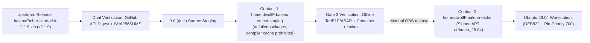

# balenaEtcher -- Native Ubuntu 26.04 LTS Package (OBS)

Debian `3.0 (quilt)` packaging specification, openSUSE Build Service (`OBS`)
remote distribution guide, and signed APT client configuration for
**balenaEtcher** (`2.1.9-1+obs1`) targeting **Ubuntu 26.04 LTS (`resolute`,
`amd64`)**.

> [!NOTE]
> This is an independent community packaging repository and is not affiliated
> with or endorsed by Balena or Canonical Ltd.

## Table of Contents

- [Overview & Context](#overview--context)
- [Why This Repository Exists](#why-this-repository-exists)
- [OBS Supply-Chain & Verification Architecture](#obs-supply-chain--verification-architecture)
- [Security & Sandbox Model](#security--sandbox-model)
- [System Requirements](#system-requirements)
- [Installation](#installation)
- [Post-Installation Verification](#post-installation-verification)
- [Updating, Rollback, and Uninstallation](#updating-rollback-and-uninstallation)
- [License](#license)

## Overview & Context

Following the sunset of Balena's upstream Cloudsmith APT repository, Ubuntu
users no longer receive maintained `.deb` security and release updates through
`apt`, while upstream release `.deb` archives fail cleanly installing or running
on **Ubuntu 26.04 LTS (`resolute`)** due to legacy dependencies, broken build
artifacts, and an AppArmor file ownership conflict.

This project provides deterministic Debian `3.0 (quilt)` repackaging of the
official upstream release archive `balenaEtcher-linux-x64-2.1.9.zip` (`v2.1.9`,
`Apache-2.0`), built remotely inside isolated OBS workers and published via the
signed APT repository
[`home:dwolfF:balena-etcher`](https://build.opensuse.org/project/show/home:dwolfF:balena-etcher).

Every release artifact is dual-verified by SHA-256 against both the GitHub
Release API asset digest and upstream `SHA256SUMS`. No third-party binary blobs,
unverified forks, or paid GitHub Actions workflows are used.

## Why This Repository Exists

Inspecting the upstream `.deb` release on Ubuntu 26.04 LTS reveals five concrete
packaging and runtime defects. The `+obs1` Debian recipe resolves all five
declaratively:

| Defect Area | Upstream `.deb` Behavior | OBS `home:dwolfF:balena-etcher` (`+obs1`) |
| --- | --- | --- |
| Binary symlink | Broken absolute symlink `/usr/lib/balena-etcher/balenaEtcher -> <ci-runner-home>/work/etcher/etcher/out/balenaEtcher-linux-x64/balena-etcher` | Fixed relative symlink `balenaEtcher -> balena-etcher` |
| Maintainer script | Broken `postinst` referencing nonexistent `/opt/balenaEtcher/...` paths | Removed broken `postinst`; clean declarative Debian packaging |
| Library & desktop deps | Unresolvable pre-`t64` names (`libasound2`, `libgtk-3-0`, `libgcc1`) and obsolete `kde-runtime`, `policykit-1-gnome` | Dynamically computed `t64` `Depends` via `dpkg-shlibdeps` (`libasound2t64`, `libgtk-3-0t64`, `libgcc-s1`, etc.) + modern `Recommends: polkit-1-auth-agent \| polkit-kde-agent-1 \| mate-polkit \| lxqt-policykit` |
| Privilege & sandbox deps | Missing runtime dependencies for privilege elevation, sandbox, portals, and TLS | Explicit `Depends: pkexec, polkitd, apparmor, xdg-utils, ca-certificates` |
| AppArmor file conflict | Ships `/etc/apparmor.d/balena-etcher`, colliding with Ubuntu 26.04 `apparmor` (`5.0.2-0ubuntu1~26.04.1`) | Deliberately omits `/etc/apparmor.d/balena-etcher`; relies cleanly on system `apparmor` (`abi <abi/5.0>`, `userns`) without `--no-sandbox` |

### Verified Remediation Details

1. **Broken absolute CI runner symlink:** Upstream's packaging pipeline emits
   `balenaEtcher` pointing to
   `<ci-runner-home>/work/etcher/etcher/out/balenaEtcher-linux-x64/balena-etcher`,
   which never exists on end-user systems. The `+obs1` package replaces this
   with a relative symlink (`balenaEtcher -> balena-etcher`).
2. **Broken `postinst` script:** Upstream's `postinst` assumes legacy `/opt/balenaEtcher/...`
   locations that do not match installed files. Removing it avoids brittle
   scriptlet failures while letting standard `debhelper` triggers handle icons,
   desktop entries, and permissions.
3. **Ubuntu 26.04 `t64` and desktop agent resolution:** Ubuntu 24.04+ transitioned
   core libraries to 64-bit `time_t` (`t64`) ABI package names (`libasound2t64`,
   `libgtk-3-0t64`, `libgcc-s1`), and deprecated `kde-runtime` /
   `policykit-1-gnome`. Computing shared-library dependencies dynamically via
   `dpkg-shlibdeps` and recommending modern Polkit agents (`polkit-1-auth-agent |
   polkit-kde-agent-1 | mate-polkit | lxqt-policykit`) guarantees clean
   resolution across GNOME, KDE Plasma, MATE, XFCE, and LXQt desktops.
4. **Missing runtime dependencies:** Explicit `Depends` on `pkexec`, `polkitd`,
   `apparmor`, `xdg-utils`, and `ca-certificates` ensures out-of-the-box Polkit
   block-device authorization, desktop URL/file integration, and sandbox
   support even on minimal Ubuntu installations.
5. **Ubuntu 26.04 `apparmor` conflict elimination:** Ubuntu 26.04's system
   `apparmor` (`5.0.2-0ubuntu1~26.04.1`) already ships and owns
   `/etc/apparmor.d/balena-etcher`. Installing an upstream `.deb` containing that
   same path aborts `dpkg` with an overwrite error. By omitting
   `/etc/apparmor.d/balena-etcher`, `+obs1` installs without file conflicts and
   uses Ubuntu's system `abi <abi/5.0>` `userns` profile cleanly instead of
   disabling Electron's sandbox with `--no-sandbox`.

## OBS Supply-Chain & Verification Architecture

Packages are produced via a two-contour OBS promotion workflow (`xUbuntu_26.04`,
`x86_64`) resolving Ubuntu 26.04 repositories in strict order (`update`,
`universe-update`, `standard`, `universe`):



- **Contour 1 (`home:dwolfF:balena-etcher:staging`):** Unpublished build
  environment enforcing `PublishFlags: nofailedpackages` and strict compiler
  cache prohibition (`Build-Conflicts: ccache, sccache` and `unexport CCACHE`)
  for clean, reproducible OBS chroot builds.
- **Gate 3 pre-release verification:** Built `.deb` artifacts undergo offline
  tarball structure checks, ELF shared-library linkage inspection, Electron ASAR
  verification, `lintian` auditing, and hardened disposable container testing
  before promotion.
- **Contour 2 (`home:dwolfF:balena-etcher`):** Direct building disabled;
  publishing enabled solely for Gate 3-verified binaries promoted via manual
  OBS release.

## Security & Sandbox Model

- **Chromium SUID sandbox (`04755 root:root`):** `/usr/lib/balena-etcher/chrome-sandbox`
  is installed with strict `04755` `root:root` ownership and setuid bit for
  unprivileged sandbox isolation when namespace fallback is required.
- **System AppArmor `abi/5.0` `userns` confinement:** Uses Ubuntu 26.04's native
  `/etc/apparmor.d/balena-etcher` profile provided by the `apparmor` package to
  grant unprivileged Chromium user namespaces cleanly.
- **Unmodified sandbox launcher:** `/usr/bin/balena-etcher` invokes the Electron
  application without injecting `--no-sandbox`.
- **Polkit privilege separation:** The GUI runs entirely as the unprivileged
  desktop user and escalates only when flashing target block devices via
  `pkexec --disable-internal-agent`, delegating credential prompts to the user
  session's Polkit agent (`polkitd` + desktop agent).
- **Disabled in-app self-updater (`packageType: "local"`):** Upstream in-app
  auto-update checks are disabled so every binary update is cryptographically
  verified and delivered exclusively through signed APT metadata.

## System Requirements

| Requirement | Supported Target |
| --- | --- |
| Operating System | Ubuntu 26.04 LTS (`resolute`) and official flavours (Kubuntu, Xubuntu, Ubuntu MATE, Lubuntu) |
| Architecture | `amd64` (`x86_64`) |
| Ubuntu Components | `main` and `universe` enabled in `/etc/apt/sources.list.d/ubuntu.sources` |
| Sandbox & Privilege Stack | `apparmor`, `polkitd`, `pkexec`, plus a desktop Polkit agent (`polkit-1-auth-agent`, `polkit-kde-agent-1`, `mate-polkit`, or `lxqt-policykit`) |
| Package Management | DEB822 APT source + scoped APT preference (`Pin-Priority: 700`) |

## Installation

1. **Install prerequisites and import the OBS repository signing key:**

   ```bash
   sudo apt-get update
   sudo apt-get install -y ca-certificates curl gpg
   sudo install -d -m 0755 /usr/share/keyrings
   curl -fsSL https://download.opensuse.org/repositories/home:/dwolfF:/balena-etcher/xUbuntu_26.04/Release.key \
     | sudo gpg --dearmor --yes -o /usr/share/keyrings/balena-etcher-obs.gpg
   sudo chmod 0644 /usr/share/keyrings/balena-etcher-obs.gpg
   ```

2. **Verify the signing key fingerprint before enabling the repository:**

   ```bash
   gpg --show-keys --with-fingerprint /usr/share/keyrings/balena-etcher-obs.gpg
   ```

   Expected key fingerprint (`home:dwolfF OBS Project`):

   ```text
   C106 E46D E757 8257 F4CD  62C9 6AE3 5907 289D 3BDC
   ```

3. **Configure the DEB822 APT repository:**

   ```bash
   sudo tee /etc/apt/sources.list.d/balena-etcher-obs.sources >/dev/null <<'EOF'
   Types: deb
   URIs: https://download.opensuse.org/repositories/home:/dwolfF:/balena-etcher/xUbuntu_26.04/
   Suites: /
   Architectures: amd64
   Signed-By: /usr/share/keyrings/balena-etcher-obs.gpg
   EOF
   ```

4. **Configure scoped APT pinning (`Pin-Priority: 700`):**

   ```bash
   sudo tee /etc/apt/preferences.d/balena-etcher-obs.pref >/dev/null <<'EOF'
   Explanation: Prefer balena-etcher packages from OBS home:dwolfF:balena-etcher
   Package: balena-etcher
   Pin: release o=obs://build.opensuse.org/home:dwolfF:balena-etcher/xUbuntu_26.04
   Pin-Priority: 700
   EOF
   ```

   > [!IMPORTANT]
   > Priority `700` is higher than standard Ubuntu archive priority (`500`) and
   > lower than forced-downgrade priority (`1000`). Only `balena-etcher` is
   > pinned; unrelated system packages remain unaffected.

5. **Refresh APT metadata and install `balena-etcher`:**

   ```bash
   sudo apt-get update
   sudo apt-get install -y balena-etcher
   ```

## Post-Installation Verification

Run the following checks after installation to confirm clean packaging, sandbox
permissions, AppArmor ownership, and APT pinning:

1. **Confirm APT resolved `balena-etcher` from OBS (`2.1.9-1+obs1`) at priority `700`:**

   ```bash
   apt-cache policy balena-etcher
   ```

2. **Confirm the relative symlink fix (`balenaEtcher -> balena-etcher`):**

   ```bash
   readlink /usr/lib/balena-etcher/balenaEtcher
   ```

3. **Verify `chrome-sandbox` SUID root permissions (`4755 root:root`):**

   ```bash
   stat -c '%a %U:%G' /usr/lib/balena-etcher/chrome-sandbox
   ```

4. **Confirm Ubuntu 26.04 AppArmor profile confinement and package ownership:**

   ```bash
   sudo aa-status | grep balena-etcher
   dpkg -S /etc/apparmor.d/balena-etcher
   ```

   `dpkg -S` should confirm `/etc/apparmor.d/balena-etcher` is owned solely by
   `apparmor` with zero file ownership conflict.

5. **Confirm the launcher wrapper never injects `--no-sandbox`:**

   ```bash
   grep -n -- --no-sandbox /usr/bin/balena-etcher || true
   ```

   Expected output: no matches.

## Updating, Rollback, and Uninstallation

### Updating

Updates are delivered through standard signed APT upgrades once new `+obs`
builds are released to `home:dwolfF:balena-etcher`:

```bash
sudo apt-get update
sudo apt-get upgrade
```

### Rollback

If an earlier `+obs` version is available in your local cache or OBS repository,
inspect available versions with `apt-cache madison balena-etcher` and install a
specific version:

```bash
apt-cache madison balena-etcher
sudo apt-get install --allow-downgrades -y balena-etcher=<previous-version>
```

### Full Uninstallation

Remove the package, APT repository definition, pin preference, and signing key:

```bash
sudo apt-get remove --purge -y balena-etcher
sudo rm -f /etc/apt/preferences.d/balena-etcher-obs.pref \
           /etc/apt/sources.list.d/balena-etcher-obs.sources \
           /usr/share/keyrings/balena-etcher-obs.gpg
sudo apt-get update
```

Published OBS project and package pages:

- [OBS Project: `home:dwolfF:balena-etcher`](https://build.opensuse.org/project/show/home:dwolfF:balena-etcher)
- [OBS Package: `balena-etcher`](https://build.opensuse.org/package/show/home:dwolfF:balena-etcher/balena-etcher)

## License

- Packaging scripts, Debian definitions, and this guide are licensed under
  [Apache-2.0](LICENSE).
- Upstream **balenaEtcher** is licensed under `Apache-2.0`.
- Bundled Electron and Chromium third-party license notices are installed on
  target systems at `/usr/lib/balena-etcher/LICENSES.chromium.html`.
